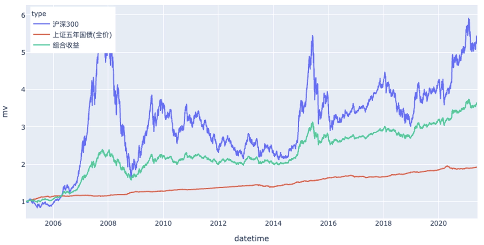
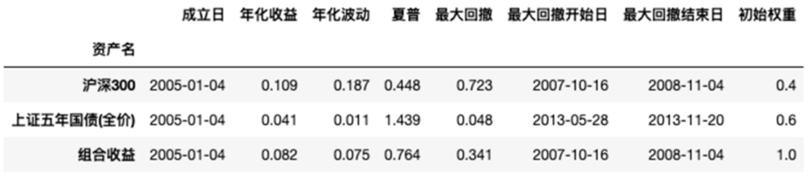

## 为什么要了解经典投资组合

上一篇介绍了资产配置的核心思想：**投资最重要的决策，不是买什么，而是如何分配资产。**

那么，一个新的问题自然出现了：**资产到底应该怎么配？有没有一种放之四海而皆准的比例？**答案是：没有。每个人的年龄、收入、风险承受能力和投资目标都不同，因此适合的资产配置也不同。

经典投资组合并不是一套可以照搬的”公式”，而是几种经过长期实践验证的**资产配置思想**：

- **股债组合**：在股票的增长与债券的稳定之间取得平衡；
- **风险平价**：追求风险均衡，而不是简单地平均分配资金；
- **永久组合**：让不同资产共同应对不同的经济环境；
- **耶鲁模式**：增加不同的收益来源，实现更加多元化的资产配置。

因此，我们需要关注的不是**哪个组合最好**，而是 **每一种组合解决了什么问题，以及它背后的思想是什么。**

## 股债组合：现代资产配置的起点

股债组合（Stock-Bond Portfolio）是最经典、也是最容易实践的资产配置方案。它的核心思想很简单：**股票负责长期增长，债券负责降低波动。**

股票具有较高的长期收益潜力，但价格波动通常也更大；债券的长期收益预期相对较低，但整体波动通常小于股票。因此，把两者组合起来，可以在收益和风险之间进行取舍。

从长期来看，一般可以理解为：

- **股票比例越高 → 收益潜力越高 → 波动和回撤通常也越大。**
- **债券比例越高 → 收益潜力越低 → 组合通常更加稳定。**





最经典的例子是 **60/40 组合**，也就是 60% 股票 + 40% 债券。除此之外，还有 80/20、70/30、40/60 等各种不同的比例。但这些数字都不是固定公式，只是针对不同风险偏好的配置方案。真正需要考虑的问题是：**为了获得更高的长期收益，我愿意承受多大的波动？**

年轻、收入稳定、投资期限较长的人，通常更有能力承受股票市场的短期波动；而投资期限较短，或者更加重视资产稳定性的人，则可能提高债券等低波动资产的比例。

不过，债券也不是股票的“保险”。在某些通胀和利率环境下，股票和债券完全可能同时下跌。因此，更准确地说，债券的作用是**降低组合长期的整体风险和波动**，而不是保证股票下跌时债券一定上涨。

所以，股债组合真正值得学习的不是 60/40 这个数字，而是：**用高收益、高波动的资产追求增长，再用相对低波动的资产控制整体风险。**

## 风险平价：资金平均，不等于风险平均

股债组合继续往下思考，就会发现一个问题：**资金比例看起来很均衡，风险真的均衡吗？**

假设股票和债券各投资 50%。

```text
股票 50%
债券 50%
```

表面上看，两类资产各占一半，非常平均。但假设股票的波动率为 20%，债券的波动率只有 5%：

```
股票：20%
债券： 5%
```

那么，即使两者投入了相同的钱，股票对整个投资组合风险的影响也会明显更大。换句话说：**资金平均，并不代表风险平均。**

风险平价（Risk Parity）就是从这里出发的。它不再单纯考虑每种资产应该投入多少钱，而是进一步考虑：**每种资产为整个投资组合贡献了多少风险？**

风险越高的资产可以少配置一些，风险越低的资产可以多配置一些，从而避免整个投资组合的风险过度集中在某一种资产上。这就是“风险平价”这个名字的含义：**追求的是风险贡献的均衡，而不是资金比例的均衡。**

### 风险平价是怎么实现的？

一种最简单的思路，是根据资产的**波动率**调整配置比例。例如：

- 股票波动大 → 权重降低；
- 债券波动小 → 权重提高。

有些简化方法会使用“波动率的倒数”来确定权重。但需要注意，这只是风险平价的一种简化实现。真正计算风险贡献时，不能只看每种资产自身的波动率，还要看资产之间的**相关性**。例如，两种资产单独看波动都很大，但如果经常反向波动，一种下跌时另一种上涨，组合之后反而能够降低整体波动。

因此，**投资组合的风险不仅取决于“每种资产有多危险”，还取决于“这些资产是不是一起危险”。**

对于普通投资者来说，并不一定需要真的去计算这些复杂的风险贡献。更值得记住的是：**资产配置不仅要看钱投到了哪里，还要看风险集中在哪里。**100 元股票 + 100 元债券，并不意味着承担了一样多的风险。**资金可以平均，风险未必平均。**这就是风险平价给资产配置带来的一个重要视角。

## 永久组合：应对不同的经济环境

如果说股债组合考虑的是**收益和风险如何平衡**，风险平价进一步考虑的是**风险如何分配**，那么永久组合（Permanent Portfolio）关注的是另一个问题：

> **如果我们根本不知道未来会发生什么，应该怎么办？**

Harry Browne 在 20 世纪 70 年代提出了永久组合。

经典永久组合的配置非常简单：

> **25% 股票 + 25% 长期国债 + 25% 黄金 + 25% 现金。**

乍一看，这个组合似乎有些奇怪。

为什么只有 25% 股票？为什么要长期持有黄金？为什么还要留 25% 现金？

原因在于，永久组合并不是单纯根据“哪种资产收益最高”来配置，而是试图让不同资产应对不同的经济环境。

| **资产** | **主要作用**                                 |
| -------- | -------------------------------------------- |
| 股票     | 经济增长时期获得收益                         |
| 长期国债 | 在经济衰退、通缩和利率下降等环境中发挥作用   |
| 黄金     | 应对高通胀和货币风险                         |
| 现金     | 提供流动性，并在紧缩、高利率等环境下保持稳定 |

永久组合背后的假设非常简单：

> **没有人能够长期准确预测未来的经济环境。**

既然不知道未来究竟是繁荣、衰退、通胀还是紧缩，与其提前押注某一种情况，不如让不同资产分别为不同的未来做好准备。

因此，永久组合并不追求最高收益。

它更加重视的是：

> **在不同经济环境下都具有一定的生存能力。**

这也是为什么它会长期持有一些在特定时期看起来“拖后腿”的资产。

牛市的时候，现金和黄金可能显得多余；但如果为了追逐当下表现最好的资产，把这些“没用”的资产全部卖掉，实际上也就破坏了永久组合原本的设计。

### 25% × 4 是重点吗？

并不是。

25%、25%、25%、25% 是 Harry Browne 给出的经典实现方式，但永久组合真正值得学习的不是这个比例，而是：

> **不要让整个投资组合依赖某一种经济环境。**

另外，永久组合诞生于数字资产出现之前，因此经典版本自然没有 Bitcoin、Ethereum 等新兴资产。

今天确实有人会把数字资产放入投资组合，但它们的波动、风险来源和历史长度都与股票、债券、黄金不同。如果配置，通常更适合把它们理解为独立的高风险资产，而不是因为“时代变了”就直接替换永久组合中的某一部分。

因此，永久组合真正值得记住的是：

> **不要预测未来，而是为不同的未来做好准备。**

## 耶鲁模式：让收益来源更加多元

前面的组合主要围绕股票、债券、黄金和现金等公开市场资产展开。

耶鲁模式（Yale Endowment Model）则把资产配置进一步扩展到了更广泛的领域。

这一模式最著名的实践者，是耶鲁大学捐赠基金前首席投资官 **David Swensen**。

传统投资组合通常把大量资金放在股票和债券上，而耶鲁基金则长期配置了更多另类资产，例如：

- 私募股权（Private Equity，PE）；
- 风险投资（Venture Capital，VC）；
- 房地产等实物资产；
- 绝对收益策略等。

它背后的一个重要思想是：

> **不要让投资组合的收益只来自少数几类资产。**

如果整个投资组合只有股票，那么无论买了多少只股票，最终仍然高度依赖股票市场。

如果进一步加入债券、房地产以及其他具有不同风险收益特征的资产，投资组合的收益来源就会更加多元。

这可以理解为：

> **收益来源的多元化（Diversification of Return Drivers）。**

### 普通投资者能复制耶鲁模式吗？

很难。

这是理解耶鲁模式时非常重要的一点。

耶鲁大学拥有普通投资者很难复制的条件：

- 专业的投资团队；
- 极长的投资期限；
- 获取优秀私募基金和基金管理人的能力；
- 承担长期缺乏流动性的能力；
- 对投资项目进行深入研究和筛选的能力。

因此，不能简单地得出：

> “耶鲁基金配置了很多 PE、VC，所以普通投资者也应该大量投资另类资产。”

对于普通投资者来说，真正值得借鉴的是它背后的**多元化思想**。

例如，如果原来的投资组合只有 A 股，可以逐渐了解：

- 全球股票；
- 不同类型和期限的债券；
- 黄金；
- REITs；
- 其他自己能够理解的资产。

重点不是追求：

> **资产种类越多越好。**

因为如果几种资产背后的风险来源高度相似，增加数量并不会带来真正的分散。

真正需要的是：

> **让投资组合拥有不同的风险和收益来源。**

所以，普通投资者不需要复制“耶鲁的资产”，但可以学习“耶鲁的思想”。

## 如何评价一个投资组合？

介绍完这些经典组合之后，还有一个很重要的问题：

> **我们应该如何判断一个投资组合表现得好不好？**

最直观的指标当然是收益率。

但只看收益率是不够的。

假设有两个组合：

```text
组合 A：年化收益 8%，最大跌幅 10%
组合 B：年化收益 8%，最大跌幅 40%
```

虽然最终年化收益一样，但两种投资体验显然完全不同。

因此，评价投资组合时，至少要同时考虑**收益和风险**。

### 年化收益率

年化收益率（Annualized Return）可以简单理解为：

> **把一段时间的投资收益折算成每年的复合增长速度。**

例如，一笔投资 10 年后从 10 万元增长到 20 万元，并不是简单地说“平均每年赚 10%”，因为投资收益还存在复利。

年化收益率能够把不同投资期限的收益转换成比较统一的尺度。

它回答的问题是：

> **这笔投资长期赚钱的速度有多快？**

### 波动率

波动率（Volatility）衡量的是：

> **投资收益上下波动的程度。**

如果一个资产每天的价格变化都很小，它的波动率通常比较低；如果价格经常大涨大跌，波动率就比较高。

在投资组合理论中，波动率经常被作为“风险”的一种衡量方式。

但需要注意：

> **波动率并不等于全部风险。**

例如，一个资产价格长期非常稳定，最后突然发生永久性损失，仅仅看之前的波动率可能无法反映这种风险。

所以，波动率是重要指标，但不能单独使用。

### 最大回撤

最大回撤（Maximum Drawdown）衡量的是：

> **历史上从一个高点到之后最低点，最多跌了多少。**

例如：

```text
100 元 → 120 元 → 90 元 → 130 元
```

从 120 元跌到 90 元：

```text
(90 - 120) / 120 = -25%
```

那么这一段的回撤就是 25%。

如果这是整个统计期间最严重的一次下跌，那么最大回撤就是 **25%**。

最大回撤非常重要，因为它比单纯的波动率更加直观地回答了一个问题：

> **如果我真的持有这个组合，历史上最难熬的时候可能是什么样？**

而且亏损和回本并不是对称的。

例如：

> 跌 50%，之后需要上涨 100%，才能回到原来的位置。

所以，收益率相同的两个组合，如果最大回撤差异很大，实际持有体验也可能完全不同。

### 夏普比率

夏普比率（Sharpe Ratio）试图把收益和风险放到同一个指标里衡量。

它的基本思想是：

> **为了获得这些额外收益，我承担了多少波动风险？**

简单表示为：

```text
夏普比率
=
（投资组合收益率 - 无风险收益率）
÷
投资组合波动率
```

例如两个组合的收益差不多，但其中一个波动明显更小，那么它通常会拥有更高的夏普比率。

因此，夏普比率衡量的不是：

> **谁赚得最多？**

而更接近于：

> **每承担一单位波动风险，获得了多少超额收益？**

不过，夏普比率同样不是万能指标。

它把波动率当作风险，但现实中的风险远不只有价格波动；对于存在极端亏损、流动性不足或者收益分布很不规则的资产，单看夏普比率可能会产生误导。

因此，评价一个投资组合时，不能只看某一个数字。

更合理的方式是把几个指标结合起来：

| **指标**   | **回答的问题**                         |
| ---------- | -------------------------------------- |
| 年化收益率 | 长期赚了多少？                         |
| 波动率     | 平时波动有多大？                       |
| 最大回撤   | 最惨的时候跌了多少？                   |
| 夏普比率   | 承担这些波动是否换来了足够的超额收益？ |

最后还需要记住一点：

> **这些指标描述的是过去，而不是未来。**

历史回测可以帮助我们理解一个投资组合在不同市场环境下的表现，但不能保证未来仍然获得相同的收益和风险特征。

## 四种经典组合的共同点

回过头来看，这四种经典资产配置思路，其实是在逐渐回答四个不同的问题：

| **组合** | **关注的问题**       | **核心思想**               |
| -------- | -------------------- | -------------------------- |
| 股债组合 | 钱怎么分？           | 在收益与风险之间进行取舍   |
| 风险平价 | 风险怎么分？         | 避免风险集中在少数资产     |
| 永久组合 | 未来无法预测怎么办？ | 用不同资产应对不同经济环境 |
| 耶鲁模式 | 收益从哪里来？       | 增加不同的风险和收益来源   |

它们并不是四套互相竞争的“标准答案”，也不存在一个适用于所有人的固定比例。

真正值得学习的是它们背后的思考方式：

> **股债组合让我开始考虑收益与风险的平衡。**

> **风险平价让我意识到，资金分散并不意味着风险分散。**

> **永久组合让我意识到，不应该让投资组合依赖对未来经济环境的预测。**

> **耶鲁模式让我意识到，真正的分散还应该来自不同的收益来源。**

因此，学习经典投资组合的目的，并不是找到一个“最优组合”然后直接照搬。

而是逐渐学会回答两个更重要的问题：

> **我的钱正在承担什么风险？**

> **我的收益又依赖什么而产生？**

当这两个问题越来越清楚时，才真正开始理解资产配置。
